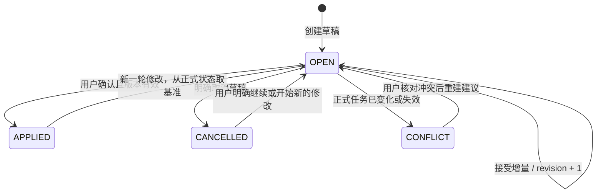

# AI 多轮事项：数据契约与状态转换

日期：2026-10-27。状态：实施规格；核心实现对应 1.2.0，实际验收结果另列。

本规格基于改造前 Room schema 1、`PlannerViewModel.send`、`ProposalValidator` 和 `Repository.applyProposal`。实施新增 `DraftEngine`、`ConversationTargetResolver` 与 `DraftRepository`，数据库升级为 schema 2。

## 1. 必须保持的约束

1. 正式事项和提醒只由 Room 的 `tasks`、`reminders` 提供给日历及系统调度。
2. 草稿可以持久化，但确认前不能写入正式提醒表或安排 AlarmManager。
3. 一条消息可以关联多个事项；多条消息可以共同补充同一个事项。
4. 引用用于确定对象身份，内容合并始终使用该对象最新草稿，不回退到被引用消息的历史快照。
5. 模型不能生成数据库 ID、版本、送达状态或操作权限；程序生成、校验并保存这些信息。
6. 未修改的提醒保持 ID 和运行状态。添加提醒不能顺便删除旧提醒、重置已送达状态。
7. 用户确认针对明确的草稿版本；旧卡片不能覆盖新草稿或新的手动修改。
8. 保留现有完整 `TaskBundle` 保存接口、事务历史及提醒恢复机制，不重写系统调度器。

## 2. 持久化数据

### 2.1 `task_drafts`：一个逻辑事项一份可持续维护的草稿

| 字段 | 契约 |
| --- | --- |
| `id` | 程序生成的 UUID；整个事项的聊天草稿身份稳定 |
| `targetTaskId` | 唯一索引；新事项首次建草稿时预留 UUID，确认时原样用作正式任务 ID；已有事项使用原 ID |
| `targetKind` | `NEW` / `SAVED`；不以标题或日期判断是否已保存 |
| `baseTaskVersion` | NEW 必须为空；SAVED 必须等于建立本轮修改基准时的正式任务版本 |
| `revision` | 从 1 开始；内容或生命周期变化时递增，不重置、不复用 |
| `status` | `OPEN` / `APPLIED` / `CANCELLED` / `CONFLICT` |
| `workingJson` | 有版本的草稿内容，见下文；不直接交给正式 DAO |
| `updatedAt` | 用于展示和查询，不作为并发控制条件 |

`targetTaskId` 不设到 `tasks` 的外键，因为 NEW 的正式任务尚不存在。Repository 必须检查 SAVED 目标存在及状态；`targetTaskId` 唯一索引保证同一个正式任务不会出现两份并行可执行草稿。APPLIED 后再次修改复用同一草稿 ID，以最新正式记录开始新修订。

`workingJson` 固定包含：

- `formatVersion=1`。
- `pendingAction=UPSERT|COMPLETE|DELETE`（存储键 action）：当前待确认动作；PATCH 对应 UPSERT。完成/删除不能被混入字段补丁。
- `fields`：标题、开始日、截止日、截止时间、类别、备注、颜色、重复规则；草稿允许缺信息，正式提交仍执行完整 `Rules.validate`。省略字段表示保留，合法 nullable 字段的显式 null 才表示清空。
- `reminders`：完整累计提醒定义，每条含稳定 ID、时间定义、重复规则和来源；不保存可由旧快照覆盖数据库的调度/送达字段。
- `reminderIntent=UNSPECIFIED|EXPLICIT`：是否已明确设置提醒，用于默认提醒规则。
- `startDateDecision=NOT_NEEDED|UNDECIDED|DATE|NONE`：对接已实现的开始日期选择。用户选过 NONE 后，不因模型再次建议 ASK 自动重新询问。

实现复用 `JsonCodec.bundle`，将业务字段保存为 `bundle.task`、提醒定义保存为 `bundle.reminders`；调度与送达字段写空占位，打开草稿和提交时从正式数据库合并当前运行状态。增加 sourceMessageId 保存当前预览的来源。以上是存储映射，不改变草稿与正式数据的边界。

提醒定义只支持当前已有的两类时间语义：`RELATIVE_MINUTES` 和 `ABSOLUTE_LOCAL`。相对提醒保存分钟数，按事项截止时刻计算；绝对提醒保存本地日期时间。不得同时让模型填写两套互相冲突的时间。

“前一天晚上 22:00”“当天 06:00”在本轮按已知事项日期解析为明确本地时刻，卡片展示结果，沿用当前独立提醒规则。完整的“日期随事项移动、钟点固定”新规则不在本次改造中悄悄引入；需要时另行设计。

### 2.2 `message_drafts`：多对多贡献关联

- 联合主键：`messageId + draftId`，两列分别关联消息与草稿。
- 解析结果被接受时，在同一事务中关联当前用户消息和助手结果；新建、补充、重复添加的无变化结果及已明确目标的追问都可建立关联。
- 目标有歧义时不关联猜测对象。失败响应不能给无关历史消息补链接。
- 保存新任务后，将该草稿所有贡献消息补齐到现有 `message_tasks`；修改已有任务同样补齐本轮关联。
- 一个批次含两个事项时，每个操作各自维护贡献集合，不能把全部引用祖先盲目关联到全部任务。
- 保留 APPLIED/CANCELLED 草稿及其关联，供历史引用定位；不删除聊天贡献记录。

### 2.3 提醒来源

`ReminderEntity` 增加 `origin=AUTO|USER|UNKNOWN`，迁移旧记录默认 UNKNOWN。

- `Rules.defaultReminder` 产生 AUTO。
- 手动添加、AI 根据用户明确要求添加或修改的提醒为 USER。模型无权指定 origin。
- 对未改动的旧提醒保留原 origin；不能因为经过 AI 就改为 USER。
- UNKNOWN 绝不能按时间、文案或“恰好前一天 09:00”猜成 AUTO。

## 3. 引用及无引用的目标解析

抽出纯逻辑 `ConversationTargetResolver`，不让 ViewModel 自行拼接多套规则。

优先级：用户明确选择的对象 → 引用消息直接关联 → 有界引用链 → 无引用的当前讨论对象 → 少量相关候选。

直接关联草稿和正式任务时，按 `targetTaskId` 去重为同一对象。定位到正式任务后，如果有 OPEN 草稿，读取草稿最新修订；若 APPLIED，读取最新正式状态。引用旧卡片的历史 bundle 永远不作为合并基准。

引用链只在当前节点没有直接关联时向上追溯，维护 visited 集合，最多 16 跳，遇到最近的有效关联即停。多目标、断链、取消的新建草稿、已完成/删除目标均不得悄悄转为其他事项；要求用户明确选择或发出恢复/另建指令。

无引用时的最小实现不新增会话服务：从最近一个已完成的用户—助手交互恢复对象。该交互必须有已持久化关联且只对应一个有效目标，才可以作为补充指令的默认候选。若最近交互无关联、有多个目标或包含未解决的目标歧义，不向更早历史扫描并自动接续。界面可展示“正在补充：事项名”。

多个关联对象保留为候选并标明 hasUniqueTarget=false，不能自动选其中一个。无执行操作的追问，只有明确引用唯一对象或模型给出经过范围校验的 clarificationTarget 才记录关联；普通闲聊和对象不确定的追问不延续旧焦点。

默认候选不是强制目标。AI 仍需区分补充与新事项；明确新标题/新事项请求可以 NEW。已有上下文却无法解释为何要另建、或可能改到其他事项时，返回澄清，不静默 CREATE。程序负责候选范围、引用范围和确认卡片，不能把模型的自信程度当成目标校验。

新关联保存后即可恢复跨消息焦点，不必无限携带历史，也不需要向量库或后台监听。

## 4. API 与增量操作协议

### 4.1 出站上下文

每次请求由程序捕获一个一致快照：目标 ID、草稿 revision、正式任务 version，以及最新累计字段和提醒定义。网络调用在数据库事务/互斥锁之外执行。

传给模型：

- 当前文字、分享内容/OCR、必要图片；不可信数据边界保持不变。
- 请求内短引用 `D1`、`T1` 等，由程序映射到实际对象和捕获版本；不允许模型自行发明引用。
- 当前目标最新字段、完整有效提醒定义、必要的已送达/停用状态说明，以及尚待选择的开始日期。
- 引用的身份和相关文字，必要的少量关联前文。引用存在时不再简单清空其他必要上下文。
- 无法确定对象时最多提供少量候选摘要；必要字段不足时询问，不能为了 Token 预算删掉关键日期、提醒或约束。

不发送 `scheduledAt`、调度登记、整份历史 before/after 和重复的引用快照。完整目标状态只发送一次；不承诺固定 Token 数，以输入信息量为准。

### 4.2 模型响应 v2

```json
{
  "protocolVersion": 2,
  "reply": "已整理补充提醒，请核对。",
  "clarification": "",
  "operations": [
    {
      "target": "D1",
      "action": "PATCH",
      "fields": {},
      "reminderPatch": {
        "mode": "MERGE",
        "add": [{"kind":"ABSOLUTE_LOCAL","localTime":"2026-11-01T22:00","repeat":"NONE"}],
        "update": [],
        "removeIds": []
      }
    }
  ]
}
```

- `target=NEW` 表示新事项，ID 由程序预留；其余 target 必须在请求允许集合内。
- `action` 为 PATCH / COMPLETE / DELETE；NEW 只能 PATCH。一次最多 10 个对象，同一既有对象每批只允许一个操作。
- `fields` 只允许当前业务字段；`startDateAdvice=ASK|NONE` 可作为可选建议，但不能覆盖已作出的选择。
- `reminderPatch` 省略表示不修改提醒，不等于清空。字段省略表示保留。
- `MERGE` 的 add 只能包含时间定义和 repeat；update 包含合法既有提醒 ID 及要修改的定义；removeIds 只能指向本目标已有提醒。同一提醒不能在一次操作里同时 update 和 remove。
- `reminderPatch` 的固定形状为：MERGE 使用 `mode/add/update/removeIds`；REPLACE_ALL 使用 `mode/items`；CLEAR 只有 `mode`，不混用其他模式字段。update 的每项为 `{id, changes}`；changes 只含 kind、relativeMinutes/localTime、repeat，修改 kind 时必须给出对应完整时间定义，并移除另一种时间定义。
- `REPLACE_ALL.items` 使用明确的完整定义列表，可给出本目标已有提醒 id，也可省略 id 表示新增；相同 id 不可重复。省略 id 但与已有定义完全等价时仍复用旧 ID 和运行状态，不能因替换操作复活已触发提醒。列表外的提醒明确删除；`CLEAR` 明确删除全部。二者都必须显式出现在操作协议与确认卡片中；旧的 `changes.reminders` 不能默认当作追加，也不能直接套入 v2。
- update/remove 使用程序提供的提醒 ID；新增提醒的 ID、origin、enabled 和运行状态均由程序生成。
- COMPLETE/DELETE 不得混带字段和提醒修改。尚未保存的事项不能“完成/删除正式任务”；可以通过明确的草稿取消操作结束草稿。
- 已有事项存在尚未确认的 UPSERT 修改时，首版先要求用户确认或取消这些修改，再建立 COMPLETE/DELETE 建议；不静默丢掉修改，也不隐式先保存再完成。取消 NEW 或 SAVED 草稿使用明确的本地操作，引用取消草稿不能自动触发恢复。
- clarification 非空时不得执行任何操作；未知字段、无关 ID、超限或非法日期拒绝整批。

### 4.3 合并顺序与幂等

1. 核对请求捕获的目标、草稿 revision 和基准版本；不采信模型回传的版本。
2. 应用字段补丁；截止变化时沿用现有规则重算未被显式修改的相对提醒，绝对提醒保持原时刻。
3. 处理显式删除、修改、添加。没有实际改变的提醒保留 ID，新增提醒只在首次成功接受响应时分配 ID。
4. 同一目标已有等价时间定义及 repeat 时，重复 add 不再创建记录，也不重新启用已触发的一次提醒。若用户明确指定的时间恰与 AUTO 相同，则保留该 ID 并将来源转为 USER，随后不能再被默认提醒清理删除。已触发后要求“再提醒一次”必须给出新的时间定义并重新确认。
5. 如果两个定义当前时间相同，但相对/绝对语义不同，不能直接认定等价；需要明确选择，避免以后延期时产生意外。
6. 应用默认提醒规则，验证提醒数量、日期、重复项及任务范围。
7. 同一事务写入草稿新 revision、消息关联、新卡片和旧卡片失效状态。失败保留旧草稿和旧卡片，不先取消再单独保存。

同一 `sourceMessageId` 的成功解析结果只接受一次。使用程序生成的确定性助手结果 ID（由 sourceMessageId 派生）和消息主键作为提交凭据；事务开头发现已接受结果时返回原结果，不再分配 ID 或应用补丁。失败消息使用独立 ID，不占用成功凭据。用户重发为新消息时，由语义去重保护重复提醒。

## 5. 默认提醒如何避免成为第六条

新草稿 `reminderIntent=UNSPECIFIED`。截止日期足够明确时可按当前规则生成一条 AUTO 建议，不能每轮重复补默认提醒。

首次明确配置提醒，将 intent 变为 EXPLICIT；仅替换仍待触发的 AUTO 默认提醒，并在确认卡片中同时列出删除与新增。用户修改 AUTO 提醒后，该条变为 USER。显式 CLEAR 后不得因后续聊天自动恢复默认提醒。

已有事项开始一轮草稿：只有现有提醒全部属于 AUTO 时才采用 UNSPECIFIED；其余（含无提醒、UNKNOWN 或 USER）默认 EXPLICIT。已有 USER/UNKNOWN 提醒绝不因一句“再加一个”被删除。已经送达的 AUTO 记录不重新启用，也不作为待触发提醒计数。

对于旧版本无法判断来源的默认提醒，保留并提示用户核对，只有明确选择替换才删除。因此“最终五条”的自动验收以新建示例或已明确来源的数据为前提，不通过猜测旧数据来源达成。

## 6. 草稿与卡片状态机



- OPEN 不代表可以提交。信息不全、未决定开始日期、有未解决歧义时显示待补充，确认按钮不可用。
- 每次内容或生命周期变化递增 revision；无变化补充只追加来源关联，不必递增或生成可执行卡片。
- APPLIED 后再次编辑需刷新正式记录和 baseTaskVersion，不能从以前 workingJson 复制过期提醒运行状态。
- CANCELLED 不自动复活。取消 SAVED 的修改只丢弃修改建议，不改变正式任务和闹钟；取消 NEW 不产生正式数据。
- 正式任务被完成或删除时，历史引用显示真实状态；恢复沿用明确的现有恢复操作，不由一句模糊补充自动触发。

沿用 `MessageEntity.proposal` 存放不可变预览与提交凭据，增加协议版本；不得用单纯变动的最新草稿替换用户正在确认的快照。

卡片至少保存：`protocolVersion`、`sourceMessageId`、每个对象的 draftId / expectedRevision / baseTaskVersion、完整预览和新增/删除摘要。卡片状态扩展为 WAITING_INPUT、PENDING、SUPERSEDED、APPLIED、DISMISSED、CONFLICT；普通消息仍用 SENT/ERROR。

新修订产生时，引用旧 revision 的卡片变为 SUPERSEDED，不再可执行。多事项卡片只要一个对象变化，旧整批就不可执行；其他对象的 OPEN 草稿仍保留，界面应能从它们生成当前版本卡片，不能把未保存事项遗失。无需在首版自动把不相关草稿重新打成一个大批次。

开始日期弹窗同样绑定 expectedRevision。选择只保留在本次确认输入中；最终提交事务校验版本、应用选择并重新完整验证。用户返回继续聊天时，不把未确认的选择写入正式任务。

## 7. 确认提交与冲突处理

`applyProposal` 在现有 repo.gate 和 Room 事务下执行：

1. 检查卡片状态、所有草稿 revision、所有正式任务 baseTaskVersion。
2. NEW 检查预留 taskId 尚不存在、重复事项校验通过；SAVED 检查原 ID 和有效状态。任何一项失败均不提交整批。
3. 从最新正式提醒中取得运行状态。未改变定义的提醒沿用当前 enabled、lastFiredLocal、scheduledAt、scheduledLocal、delivery，而非草稿建立时的状态。
4. 实际修改提醒时间/规则时，按现有规则清理旧调度登记并生成新的待调度状态；仅新增一条时不影响其他提醒。
5. 将草稿转换为完整 TaskBundle，调用现有保存/完成/删除逻辑；同一事务保存历史、正式消息关联、APPLIED 卡片和草稿状态。
6. 提交成功后才调用 `afterChange`；它继续恢复提醒和刷新组件。

提醒在草稿期间触发不改变 task.version；因此必须执行第 3 步。手动编辑、完成、删除等内容变化会改变版本，必须冲突检查。网络响应到达时草稿已变化也应拒绝，不直接覆盖最新草稿。

发生冲突时保留用户本次意图和旧预览，展示正式记录与建议差异，由用户重新核对后形成新 revision。不在首版实现会自动丢字段的通用三方合并器。

事务失败：正式数据与草稿保持原状，可重试。事务成功但系统同步失败：卡片仍为 APPLIED，提示“已保存、提醒待恢复”；只能重试 afterChange，不能再次创建任务或重复应用补丁。

如果需要把失败原因持久化为 CONFLICT，应在失败后单独进行仅涉及草稿/卡片元数据的事务，先比较 revision 防止覆盖更新；不能先改状态再通过抛异常把该标记一并回滚。任何失败都不允许部分写入正式任务或提醒。

## 8. A → B → C → D 的确定性验收

固定测试时间为 2026-10-27，事项时刻为 2026-11-02 15:00。

| 消息 | 目标解析 | 合并结果（未来待触发提醒） |
| --- | --- | --- |
| A：11月2日下午3点要抢报课名额 | 创建 D1，预留 T1 | 事项建立，可有 11月1日09:00 AUTO 建议 |
| B：无引用，提前一小时、十分钟、一分钟提醒 | 最近明确交互唯一目标 D1 | 首次明确配置替换 AUTO；14:00、14:50、14:59 共3条 |
| C：引用 B，再加前一天晚上10点 | B → D1，读取最新 revision | 新增 11月1日22:00，共4条 |
| D：引用 A，当天早上6点也提醒 | A → D1，仍读取最新 revision | 新增 11月2日06:00，共5条 |

无论全部最后确认、A 先确认后连续补充，还是每轮确认，最终正式任务都必须是 T1，最后五条提醒相同。未变的三条提醒 ID 在后续增量与确认中不变；A/B/C/D 都能定位 T1。全部未确认时正式表和系统闹钟均没有 T1。

## 9. 数据迁移与兼容

- Room 1 → 2：新增 task_drafts、message_drafts、必要索引，给 reminders 新增 origin，默认 UNKNOWN；注册显式 Migration，禁止 destructive migration。现有 tasks/reminders 主键、时间、状态及历史不变。
- 旧 PENDING 卡片保留内容但迁移为 DISMISSED，并显示“旧版建议需重新解析”；不猜测哪些旧卡片属于同一草稿，不自动执行旧协议。已保存任务及历史关联照常可用。
- 新协议只接受显式 v2；旧 APPLIED 卡片可继续按旧结构显示，但不能重新执行。旧卡片中的多个 operations 不能被合并为一个事项。
- JSON 备份写 v2，读取兼容 v1/v2。v1 缺失 origin 时为 UNKNOWN；恢复时保持原有本机 API/Key 保护。
- v2 包含草稿及消息—草稿关联；恢复后的 OPEN/CONFLICT 草稿保留内容但必须重新验证并产生新确认卡片，所有导入的可执行卡片先失效。正式数据库和系统提醒只从恢复后的正式任务重建，不能从草稿调度。
- 所有序列化/历史兼容处理集中在 JsonCodec 和 Backup；为未知协议、孤立关联和非法状态提供明确错误。

## 10. 实施顺序与必要检查

1. 实现独立的目标解析、补丁类型和合并函数；用固定时间和固定响应覆盖 A/B/C/D、混合引用、多目标、增量去重及默认提醒语义。
2. 实现新实体、DAO、Migration、序列化和草稿事务；验证迁移不改变旧 ID/送达状态、批次失败回滚、同一 source 幂等、旧卡片无法确认。
3. 接入 ViewModel 与 AiClient；新增必要的草稿/过期提示，复用已有任务卡片和日期确认界面，不做 UI 美化。
4. 用少量 Room 集成测试覆盖三种确认时机、进程重建、手动编辑冲突、提醒触发后再补充；一次针对性的真实提醒衔接检查即可。

最终验收边界：正式任务数量正确、关联正确、五条提醒完整、未改提醒 ID/送达状态不变、未确认不调度、错误不假报成功。不重复运行主题和所有组件尺寸测试，不把多次付费模型调用当作程序正确性的证明。

高推理模型负责审查目标解析、默认提醒语义、合并/冲突/提交边界及迁移方案。实体/DAO、序列化、已明确的迁移实现、卡片状态展示和固定测试夹具可以交给较轻量模型；完成后对照本契约集中审查。
